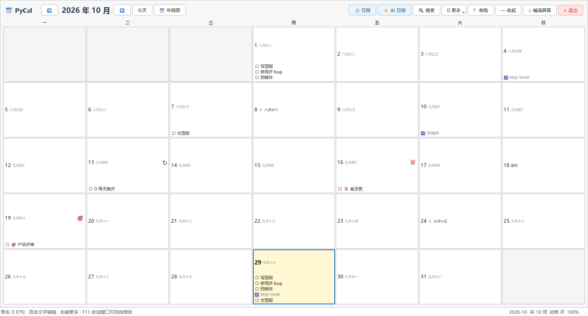
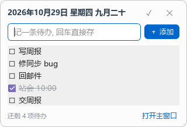
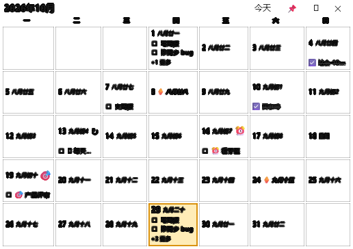
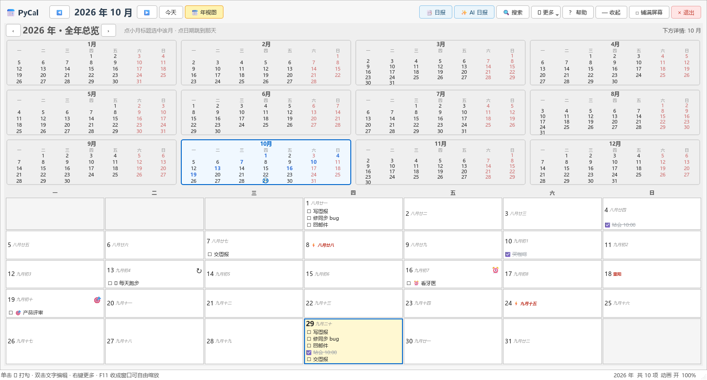

<div align="center">

# PyCal

**一个能贴在桌面上的日历 —— 铺满整屏当背景，或者缩成角落里的小挂件。**

[](https://github.com/koixlw/CalendarTask/releases/latest)
[](LICENSE)
[](https://www.python.org/)
[](https://learn.microsoft.com/windows/)

[下载 Windows 版](https://github.com/koixlw/CalendarTask/releases/latest) ·
[使用手册](docs/使用手册.md) ·
[问题反馈](https://github.com/koixlw/CalendarTask/issues)

</div>

---



PyCal 是一个**离线的桌面日历**：日程、待办、提醒、倒数日都存在你自己电脑上，
不联网也能用；想同步就自己接 CalDAV（Google / iCloud / Outlook 都支持）。

界面就是一张月历 —— 双击格子写事，点左边的 ☐ 打勾，别的没了。

## 能干什么

| | |
|---|---|
| **月视图 / 年视图** | 月视图一屏看一个月，年视图一屏看一年 —— 点月份标题切，点某天直接跳过去 |
| **一格能写多行** | 一格里的每一行都能单独打勾，不是「一个格子一个待办」 |
| **农历和节气** | 每个日期下面带农历、二十四节气、传统节日 |
| **桌面挂件** | 一个小月历贴在**桌面层**，格子透明让壁纸透出来，字带描边，在什么壁纸上都看得清 |
| **快捷待办小窗** | 点右下角托盘图标就弹出来，输入框直接打字**回车就存**，不用碰鼠标 |
| **提醒** | 到点从托盘弹通知，确认一下就消失 |
| **日报 / 周报** | 自动从你的条目里算出完成率、每日矩阵、类型分布，还能用 AI 改写得更通顺 |
| **云同步** | CalDAV 双向同步，冲突自动处理；同步账号和应用专用密码只存在本机 |
| **倒数日** | 「还有 47 天」这种，日报周报里也会带上 |
| **4 种皮肤 + 字号缩放** | 85% 到 150% 无级调，行高和格子跟着走；窗口能自由拖边缩放 |

<details>
<summary>还有这些</summary>

- 桌面便签（浮贴纸）
- 把日历暴露给 AI 代理（MCP server，4 个 tool）
- 从 DesktopCal 导入既有数据（两库并存，不冲突）
- Windows 开机自启（HKCU Run，不触发 UAC）、桌面快捷方式、完整卸载器

</details>

## 下载

**Windows 用户去 [Releases 页](https://github.com/koixlw/CalendarTask/releases/latest)**
下 `PyCal.exe` 就行 —— 单文件（约 73 MB），双击就能跑，不用装 Python。

1. 下载 `PyCal.exe`
2. 右键 → 属性 → 底部勾上「解除锁定」→ 确定
   （Windows 10 以后从浏览器下的文件都会带这个标记，不解除 sometimes 双击没反应）
3. 双击运行

> 这是**未签名**的程序，第一次运行 SmartScreen 可能拦一下。
> 点「更多信息」→「仍要运行」即可。
>
> 杀毒软件误报是 PyInstaller 单文件程序的通病（会把程序解到临时目录再跑），
> 出现误报可以来开 issue。

**数据存在 `%APPDATA%\PyCal\`**，卸载 exe 不会删掉你的日历。
想彻底清干净：删 exe，再删 `%APPDATA%\PyCal\`。

<details>
<summary>从源码跑（macOS / Linux / 想改代码的）</summary>

需要 Python 3.10+。

```bash
git clone https://github.com/koixlw/CalendarTask.git
cd CalendarTask
python -m pip install -e .
python run.py
```

或者不装包，直接跑：

```bash
python -m pip install PySide6 lunardate mcp caldav icalendar recurring-ical-events anthropic
python -m pycal gui
```

</details>

## 上手

### 写第一条

**双击**格子里的空白处 → 弹出编辑器 → 写内容 → 保存。

内容可以写多行：

```
写周报
修同步 bug
回邮件
```

每一行都是独立的一条，能单独打勾。

### 打勾

点文字**左边**的 ☐。一格写了多行的话，点哪行勾哪行。

### 其他操作

| 操作 | 结果 |
|---|---|
| 双击条目的文字 | 打开编辑器改 |
| 右键格子 | 新建（格子 / 重复任务 / 提醒 / 倒数日）、编辑、删除、复制 |
| 点左下角 ☐ | 一键把今天没做完的都勾上 |

### 快捷键

| 键 | 作用 |
|---|---|
| <kbd>F1</kbd> | 帮助（应用内三页说明） |
| <kbd>F11</kbd> | 铺满屏幕 / 收成窗口（收成后能自由缩放） |
| <kbd>Ctrl</kbd>+<kbd>N</kbd> | 今天新建条目 |
| <kbd>Ctrl</kbd>+<kbd>F</kbd> | 搜索 |
| <kbd>Ctrl</kbd>+<kbd>R</kbd> | 日报 / 周报 |
| <kbd>Ctrl</kbd>+<kbd>Shift</kbd>+<kbd>R</kbd> | AI 润色 |
| <kbd>Ctrl</kbd>+<kbd>S</kbd> | 云同步 |
| <kbd>Ctrl</kbd>+<kbd>T</kbd> | 回到今天 |
| <kbd>Y</kbd> | 切换年视图 / 月视图 |
| <kbd>Esc</kbd> | 关闭窗口（默认收起到托盘，程序继续在后台跑） |

## 桌面集成

### 快捷待办小窗



**单击**右下角托盘图标就弹出来。输入框自动带焦点，**打完字按回车就存成今天的待办**，
一次写多行就是好几条。

面板随便拖，挪到哪下次打开还在原地。里面勾掉的待办，月视图格子里的 ☐ 跟着变。

### 桌面挂件



一个小月历贴在**桌面层** —— 别的窗口能盖住它，不会跳出来抢你正在写的东西。
格子透明，壁纸从缝里直接透出来；文字自带描边，所以深色浅色壁纸都看得清，
色还会跟着你那块壁纸的亮度自动反。

想让它浮在最上面，在挂件标题栏的「⋯」里切「永远置顶」。

### 关窗 ≠ 退出

PyCal 默认驻留后台 —— 提醒和自动同步靠它。

| 操作 | 结果 |
|---|---|
| <kbd>Alt</kbd>+<kbd>F4</kbd> / 任务栏 ✕ | 第一次弹框问「收起到托盘」还是「直接退出」；之后按上次的来 |
| 点「— 收起」 | 直接收起到托盘 |
| 点「× 退出」 | 永远真退出 |

托盘图标：**单击** = 快捷待办小窗，**双击** = 打开主窗口，右键 = 菜单。

## 年视图



点工具栏「📆 年视图」（或按 <kbd>Y</kbd>）。

一屏摆下 12 个小月，有条目的日子**加粗变蓝**，今天是黄底圆圈，周末那两列偏红。
点**月份标题**选中那个月，点**某一天**直接跳到那天。

下面那块详情就是完整的月视图 —— 勾选、双击编辑、右键菜单都跟平时一模一样。

## 日报 / 周报

工具栏「📑 日报」。自动从条目里算出：

- **完成率**（按行统计，不是按条）
- **每日完成矩阵** + 🟢🟡🔴 评级
- **类型分布**、**高频关键词**
- **倒数日**、**下周预告**

可以存成 Markdown、导出 HTML（带打印样式，浏览器 <kbd>Ctrl</kbd>+<kbd>P</kbd> 就是 PDF），
也可以让 AI 改写得更通顺、更专业。

<details>
<summary>AI 润色要配 key</summary>

界面里填就行：工具栏「⋯ 更多 → 🔑 AI 润色 API key」（或 <kbd>Ctrl</kbd>+<kbd>,</kbd>）。
Key 从 [console.anthropic.com](https://console.anthropic.com/settings/keys) 拿。

不想在界面里留痕就用环境变量：

```powershell
$env:ANTHROPIC_API_KEY = "sk-ant-..."
```

</details>

## 云同步

支持 CalDAV：Google、iCloud、Outlook、还有自建的 Nextcloud 等。

工具栏「⋯ 更多 → 云同步」。**注意要用应用专用密码，不是主账号密码** ——
各服务商的申请链接在界面里会直接给你。

- 冲突策略：默认按「最新修改的赢」，也能改成「本地赢」或「云端赢」
- 可以设成只读（只拉不推）、或单向（只拉 / 只推）
- 后台每 15 分钟自动同步一次

> OAuth 还没做，得走应用专用密码。

## 命令行

装了之后有这些命令：

```bash
pycal gui                                  # 起界面
pycal import                               # 从 DesktopCal 导入
pycal search "周报"                         # 命令行搜索
pycal report --week --html --out ./out     # 生成本周周报 (HTML)
pycal sync list                            # 列出同步账号
pycal install --status                     # 看安装状态
pycal --version
```

不带 `pycal` 的话用 `python -m pycal ...`，效果一样。

完整列表见 [使用手册](docs/使用手册.md)。

## 数据和隐私

- **所有数据都在本机**：`%APPDATA%\PyCal\db\pycal.db`，一个 SQLite 文件
- PyCal **不往任何第三方发数据**
- 唯一的对外请求是你自己配的 CalDAV 服务器，以及你点了「AI 润色」时的 Anthropic API
- 界面里填的 API key 和 CalDAV 密码存在同一个 DB 里，用 base64 + XOR 混淆
  —— **这是防「随手打开 DB 看到明文」，不是加密**。想更稳就用环境变量
  （`ANTHROPIC_API_KEY`），或者别在本机存。

## 开发

```bash
python -m pip install -e .
python -m pytest tests/ -q     # 跑测试
python build.py --onefile      # 打包成单文件 exe
```

打包成 exe 需要 `pip install pyinstaller`。

发布流程：改 `pycal/__init__.py` 里的 `__version__`，打 `v*` 标签，
GitHub Actions 自动打包并发布 Release。

细节看 [CONTRIBUTING.md](CONTRIBUTING.md) 和 [技术细节](docs/技术细节.md)。
搜索是怎么实现的，见 [DesktopCal 搜索机制复盘](SEARCH_ANALYSIS.md)。

## 常见问题

**Q：杀毒软件报毒？**
单文件 exe 会把自己解到临时目录再运行，误报很常见。程序本身不发任何网络请求
（除了你配的同步账号和 AI 润色）。

**Q：装在别的电脑上数据会丢吗？**
不会丢 —— 数据在 `%APPDATA%`，跟程序装在哪没关系。但 exe 本身不跨机器通用，
每个平台要单独打包。

**Q：能同步到手机吗？**
PyCal 走标准 CalDAV，只要你的手机端日历 App 也支持 CalDAV（比如 iOS 自带的
「日历」App 里的「其他账户 → CalDAV」），就能一起用。

**Q：为什么关掉窗口程序还在？**
提醒和自动同步需要它常驻。点工具栏「× 退出」才是真退出。

## 致谢

- [PySide6](https://doc.qt.io/qtforpython/) —— 界面
- [lunardate](https://pypi.org/project/lunardate/) —— 农历换算
- [CalDAV](https://tools.ietf.org/html/rfc4791) —— 同步协议

## 说明

PyCal 是**独立实现**，与 DesktopCal 及其厂商没有任何关联，也不包含它们的代码。

## License

[MIT](LICENSE)
